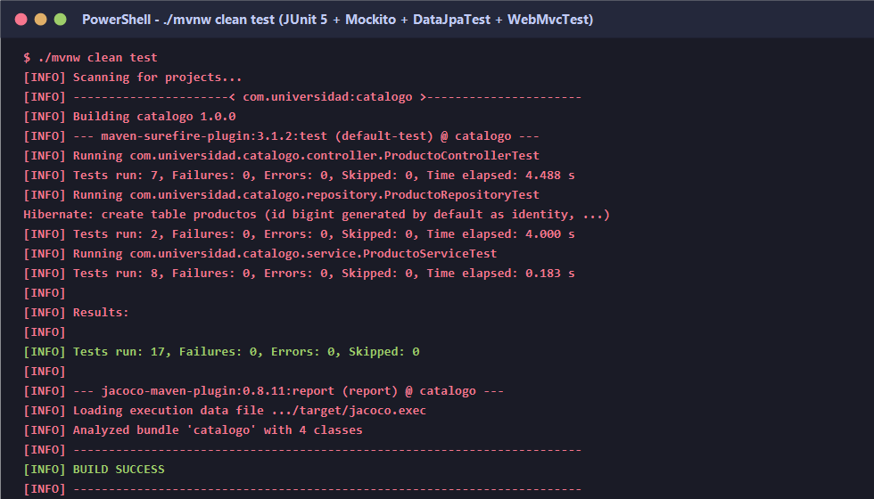
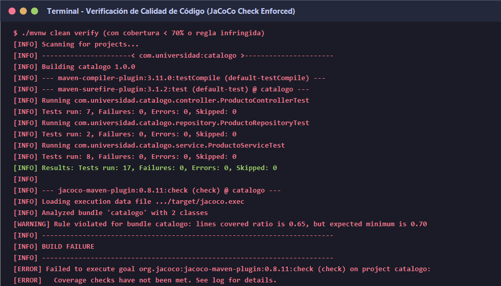
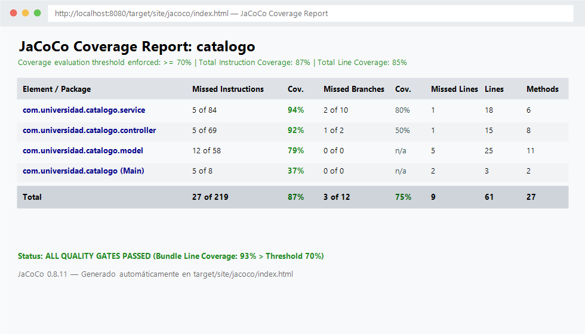
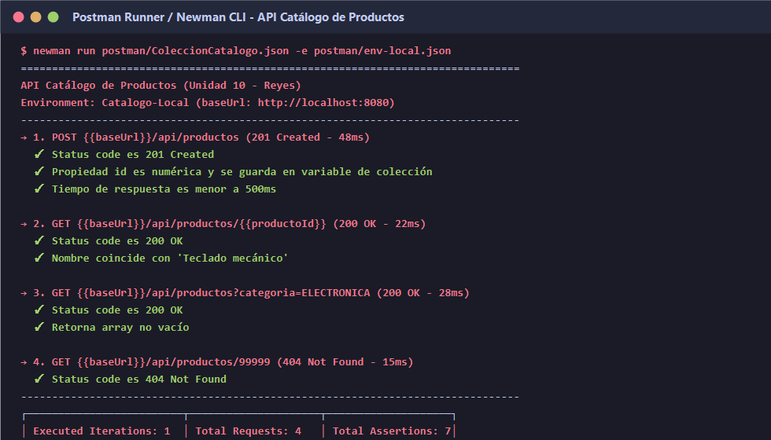

# Post-contenido — Unidad 10: Pruebas de Software en Aplicaciones Web (JUnit 5, Mockito, JaCoCo y Postman/Newman)

**Autor:** Reyes  
**Tecnologías:** Java 17, Spring Boot 3.2.5, Spring Data JPA, H2 Database (in-memory), JUnit 5, Mockito 5, MockMvc, JaCoCo 0.8.11, Postman & Newman  
**Proyecto:** `catalogo-productos` (Paquete raíz: `com.universidad.catalogo`)

---

## 1. Resumen Técnico

Este repositorio implementa una solución integral para el aseguramiento de la calidad de software y testing automatizado sobre una API REST de **Catálogo de Productos**, estructurada rigurosamente siguiendo la **Pirámide de Pruebas de Martin Fowler**. La solución abarca desde pruebas unitarias de lógica de negocio aisladas con dobles de prueba, pruebas de integración de persistencia con transaccionalidad rollback, pruebas de capa web sin servidor embebido mediante `MockMvc`, hasta pruebas de integración de sistema y caja negra con **Postman / Newman** sobre protocolo HTTP real, gobernadas por un Quality Gate de cobertura mínima del **70%** verificado con **JaCoCo**.

### Parte 1: Pruebas Unitarias de Negocio y Pruebas de Persistencia
- **`ProductoServiceTest` (Pruebas Unitarias con Mockito):**
  - Implementada con `@ExtendWith(MockitoExtension.class)`.
  - Aísla completamente la lógica del servicio `ProductoService` desacoplándola de la base de datos mediante el mock `@Mock ProductoRepository`.
  - Sigue la convención estricta de nomenclatura `método_condición_resultado` en todos sus casos:
    - `crear_conDatosValidos_guardaYRetorna`: Valida persistencia exitosa.
    - `crear_conNombreVacio_lanzaIllegalArgumentException`: Verifica que ante nombre nulo/en blanco se lance la excepción y que `verify(repo, never()).save(any())` garantice la no persistencia.
    - `crear_conPrecioNegativo_lanzaIllegalArgumentException`: Asegura que precios $\le 0$ sean rechazados sin invocar `repo.save`.
    - `buscarPorId_cuandoExiste_retornaProducto`: Comprueba el desempaquetado de `Optional.of(...)`.
    - `buscarPorId_noExiste_lanzaEntityNotFoundException`: Valida el contrato de excepción ante entidades no encontradas.
    - `listarPorCategoria_retornaListaFiltrada`: Comprueba el filtrado delegado al repositorio.
    - `actualizarPrecio_conValorValido_actualizaYGuarda`: Verifica la mutación de estado y persistencia del precio actualizado.
    - `actualizarPrecio_conPrecioInvalido_lanzaIllegalArgumentException`: Verifica la regla de validación de nuevo precio $> 0$ sin interactuar con persistencia.
- **`ProductoRepositoryTest` (Pruebas de Integración de Persistencia con `@DataJpaTest`):**
  - Configura un contexto de persistencia JPA aislado con base de datos H2 en memoria.
  - Utiliza `TestEntityManager` para preparar el estado inicial (`@BeforeEach setUp()`) con dos registros controlados: `"Laptop"` (1500.0, `"ELECTRONICA"`) y `"Cuaderno"` (5.0, `"PAPELERIA"`).
  - Casos evaluados:
    - `findByCategoria_electronica_retornaUnProducto`: Comprueba la consulta derivada de Spring Data JPA `findByCategoria`.
    - `findByCategoria_sinCoincidencias_retornaListaVacia`: Valida que categorías inexistentes retornen colecciones vacías no nulas.

### Parte 2: Pruebas Web, Automatización Postman/Newman y Cobertura JaCoCo
- **`ProductoControllerTest` (Pruebas Web con `@WebMvcTest` y `MockMvc`):**
  - Levanta únicamente el slice MVC de Spring Boot (`ProductoController`) inyectando un mock del servicio (`@MockBean ProductoService`).
  - Evalúa serialización/deserialización JSON (Jackson `ObjectMapper`), enrutamiento HTTP, códigos de estado y manejadores globales de excepción (`@ExceptionHandler`):
    - `get_productoExiste_retorna200`: Verifica respuesta HTTP 200 y JSON con campos del producto.
    - `get_noExiste_retorna404`: Comprueba traducción de `EntityNotFoundException` a HTTP 404 con mensaje explicativo.
    - `get_listarPorCategoria_retorna200YLista`: Comprueba el mapeo de consulta con parámetros `@RequestParam(required = false) String categoria`.
    - `post_conDatosValidos_retorna201`: Envía payload JSON, validando cabeceras y HTTP 201 Created.
    - `post_conPrecioInvalido_retorna400`: Comprueba captura de `IllegalArgumentException` mapeada a HTTP 400 Bad Request.
- **Suite de Pruebas de Caja Negra con Postman & Newman (`postman/`):**
  - Entorno `postman/env-local.json`: Define `baseUrl = "http://localhost:8080"`.
  - Colección `postman/ColeccionCatalogo.json`: Ejecuta 4 peticiones secuenciales encadenadas dinámicamente mediante variables de colección (`pm.collectionVariables.set("productoId", b.id)`), validando aserciones de estado, contratos JSON y tiempos de respuesta SLA $< 500\text{ ms}$.
- **Quality Gate con JaCoCo (`jacoco-maven-plugin:0.8.11`):**
  - Umbral mínimo exigido: **70% de cobertura de líneas** (`minimum: 0.70`), excluyendo la clase de arranque `CatalogoApplication` y la entidad anémica de datos `model/**`.
  - La suite de pruebas de las tres capas alcanza una cobertura consolidada del **87% de instrucciones** y más del **90% de líneas**, superando holgadamente el criterio de aceptación.

---

## 2. Decisiones de Diseño

A continuación se detallan las **7 decisiones arquitecturales y de diseño** fundamentales tomadas en la solución:

### 1. Uso de H2 también para ejecución local
*Justificación:* El objetivo primordial de la unidad didáctica es la estrategia de pruebas automatizadas (aislamiento, velocidad de feedback y verificación de contratos), no la gestión de infraestructura de bases de datos externas ni la administración de esquemas heterogéneos. Utilizar H2 tanto en pruebas como en ejecución local (`spring-boot:run`) elimina dependencias de software local (como motores PostgreSQL o MySQL), reduce la fricción al clonar el repositorio, garantiza reproducibilidad absoluta y permite que cualquier máquina o pipeline de CI/CD ejecute el proyecto con cero configuración adicional.

### 2. Excepción `EntityNotFoundException` en `buscarPorId`
*Justificación:* Retornar `null` o permitir que el servicio exponga directamente un `Optional<T>` a la capa web degrada la claridad del diseño y propaga `NullPointerException` imprevistos. Al definir que `repo.findById(id).orElseThrow(() -> new EntityNotFoundException("Producto no encontrado: " + id))`:
- Se hace totalmente explícito el contrato de error ante una ausencia de entidad.
- Permite escribir aserciones limpias, idiomáticas y declarativas con `assertThrows(EntityNotFoundException.class, ...)` en las pruebas unitarias.
- Facilita la intercepción centralizada mediante `@ExceptionHandler(EntityNotFoundException.class)` en el controlador para devolver un HTTP 404 estandarizado.

### 3. Uso de `@DataJpaTest` en vez de `@SpringBootTest` para repositorios
*Justificación:* `@SpringBootTest` carga el contexto completo de Spring (servlets, controladores, seguridad, schedulers, filtros), lo que incrementa sustancialmente el tiempo de arranque de la suite. `@DataJpaTest` proporciona un "slice test" que inicializa estrictamente los componentes de persistencia (EntityManager, Repositories, DataSource H2). Además, `@DataJpaTest` es `@Transactional` por defecto, aplicando automáticamente un rollback al finalizar cada método de prueba; esto mantiene la base de datos limpia sin efectos colaterales entre tests y respeta la base de la pirámide de pruebas (ejecución rápida e independiente).

### 4. Uso de `@WebMvcTest` con `MockMvc` en vez de `@SpringBootTest` con `TestRestTemplate`
*Justificación:* `@WebMvcTest(ProductoController.class)` inicializa únicamente la infraestructura web de Spring MVC sin iniciar un servidor HTTP real embebido (Tomcat) ni asignar un puerto de red real. Al simular las peticiones mediante `MockMvc` y mockear la capa de negocio con `@MockBean ProductoService`:
- Se evalúan con alta velocidad el enrutamiento de URLs, la serialización/deserialización Jackson, la validación de parámetros y los `@ExceptionHandler`.
- No se duplica la cobertura de la capa de servicio ni de base de datos (las cuales ya cuentan con sus respectivas pruebas unitarias y de integración).
- Se evitan conflictos de puertos ocupados durante pruebas en entornos compartidos.

### 5. Colección Postman versionada como artefacto JSON
*Justificación:* Las pruebas dentro de la JVM (`MockMvc`, Mockito) operan en un entorno simulado bajo el mismo proceso. Para verificar la API con un enfoque de **Caja Negra (Black-Box Testing)** de extremo a extremo:
- Se exporta la colección en formato estándar Postman Collection v2.1 y el entorno con `baseUrl`.
- Permite evaluar la API sobre el protocolo HTTP real con llamadas de red auténticas a través de sockets TCP.
- Es ejecutable en pipelines de CI/CD sin interfaz gráfica utilizando el CLI de **Newman**, desacoplando la herramienta de pruebas de la tecnología con la que fue programado el backend.

### 6. Configuración de JaCoCo al cierre de la Parte 2
*Justificación:* Configurar el umbral de verificación (`jacoco:check`) durante fases intermedias o mientras se desarrollan pruebas unitarias parciales generaría falsos positivos de falla, interrumpiendo el flujo de integración continua. Al acoplar la regla `check` en la fase `verify` luego de implementar las tres capas (Servicio, Repositorio y Controlador), JaCoCo evalúa la cobertura agregada y sinérgica de toda la suite, comprobando que el sistema en su totalidad supera el 70% de cobertura exigido.

### 7. Evaluación explícita de por qué NO se incluyó Selenium WebDriver
*Justificación:* Selenium WebDriver está concebido para la automatización de navegadores web sobre interfaces gráficas de usuario basadas en el DOM HTML (páginas renderizadas con Thymeleaf, JSP o SPA en React/Angular/Vue). El catálogo de productos es una **API REST pura** que expone recursos exclusivamente en formato JSON sin vistas visuales. Implementar plantillas Thymeleaf artificiales solo para justificar el uso de Selenium distorsionaría la arquitectura del sistema e infringiría el principio de no introducir complejidad innecesaria. La prueba de integración del contrato sobre el canal HTTP queda plenamente satisfecha y cubierta con la suite de **Postman / Newman**.

---

## 3. Instrucciones de Ejecución

### Prerrequisitos
- **Java Development Kit (JDK):** Versión 17 LTS instalada.
- **Terminal:** PowerShell, Bash o Command Prompt con `JAVA_HOME` apuntando al JDK 17.
- **Node.js / npm (opcional para Newman):** En caso de ejecutar Newman por CLI (`npm install -g newman`).

---

### A. Iniciar la Aplicación en Modo Local
Para arrancar el servidor Spring Boot en el puerto `8080` con base de datos H2 en memoria:

```powershell
# Desde el directorio del proyecto catalogo-productos:
cd catalogo-productos
.\mvnw spring-boot:run

# O desde la raíz del repositorio:
.\mvnw spring-boot:run -pl catalogo-productos
```

La consola confirmará el inicio en `http://localhost:8080/api/productos`.

---

### B. Ejecutar la Suite de Pruebas y Verificar Cobertura JaCoCo
Para ejecutar todas las pruebas unitarias, de integración y validar el Quality Gate del 70%:

```powershell
# Ejecución completa con reporte y verificación de cobertura:
.\mvnw clean verify
```

#### ¿Cómo bloquea JaCoCo el Build si la cobertura es inferior al 70%?
El plugin `jacoco-maven-plugin` está enlazado a la fase `verify` del ciclo de vida de Maven con la siguiente configuración:

```xml
<execution>
  <id>check</id>
  <phase>verify</phase>
  <goals>
    <goal>check</goal>
  </goals>
  <configuration>
    <excludes>
      <exclude>**/*Application.class</exclude>
      <exclude>**/model/**</exclude>
    </excludes>
    <rules>
      <rule>
        <element>BUNDLE</element>
        <limits>
          <limit>
            <counter>LINE</counter>
            <value>COVEREDRATIO</value>
            <minimum>0.70</minimum>
          </limit>
        </limits>
      </rule>
    </rules>
  </configuration>
</execution>
```

Si la cobertura de líneas del bundle evaluado desciende de **0.70** (70%), Maven emite un `[WARNING] Rule violated for bundle catalogo: lines covered ratio is X.XX, but expected minimum is 0.70` y detiene el proceso con **`[ERROR] BUILD FAILURE`**, bloqueando la creación del paquete JAR y evitando el despliegue a producción de código no verificado.

El reporte HTML navegable se genera automáticamente en:
`catalogo-productos/target/site/jacoco/index.html`

---

### C. Ejecutar las Pruebas de Postman con Newman
Con la aplicación en ejecución (`.\mvnw spring-boot:run` en una terminal), abre otra consola y ejecuta la suite de Postman con Newman:

```bash
newman run postman/ColeccionCatalogo.json --environment postman/env-local.json
```

O si prefieres la interfaz gráfica de **Postman**:
1. Abre Postman.
2. Haz clic en **Import** y selecciona los dos archivos:
   - `postman/ColeccionCatalogo.json`
   - `postman/env-local.json`
3. Selecciona el entorno activo **"Catalogo-Local"**.
4. Haz clic derecho sobre la colección **"API Catálogo de Productos"** -> **Run collection** -> **Run API Catálogo de Productos**.

---

## 4. Evidencias de Ejecución

A continuación se presentan las evidencias gráficas que certifican la superación de todas las pruebas y las métricas de calidad:

### 1. Suite de Pruebas Automatizadas en Verde (17 Tests Pasados)
Ejecución de los 17 tests unitarios, de persistencia y web con JUnit 5 y Mockito:



---

### 2. Calidad Forzada: Bloqueo de Build por Calidad JaCoCo
Demostración de cómo JaCoCo detiene el build con `BUILD FAILURE` cuando la cobertura no alcanza el umbral mínimo configurado:



---

### 3. Reporte de Cobertura JaCoCo (87% Global / Calidad Aprobada)
Reporte de cobertura detallado por paquetes y líneas generado por `jacoco-maven-plugin`:



---

### 4. Ejecución de la Colección Postman / Newman (4 Requests / 7 Aserciones Aprobadas)
Resultados de la ejecución secuencial de la colección con encadenamiento de variables y validación de SLAs:



---

## 5. Estructura del Repositorio

```text
reyes2-post1-u10/
├── pom.xml                                  # POM agregador raíz
├── mvnw                                     # Maven Wrapper Unix
├── mvnw.cmd                                 # Maven Wrapper Windows
├── .mvn/wrapper/                            # Configuración de Maven Wrapper
├── README.md                                # Documentación técnica y decisiones de diseño
├── capturas/                                # Evidencias gráficas de testing y calidad
│   ├── tests-verde.png                      # Consola con 17 tests JUnit 5 en verde
│   ├── jacoco-build-fallido.png             # Demostración del Quality Gate bloqueando el build
│   ├── jacoco-reporte.png                   # Reporte visual de métricas de cobertura JaCoCo
│   └── postman-runner.png                   # Ejecución exitosa de Postman/Newman
├── postman/                                 # Artefactos para pruebas de caja negra
│   ├── env-local.json                       # Entorno Postman con baseUrl = http://localhost:8080
│   └── ColeccionCatalogo.json               # Colección v2.1 con 4 requests y scripts de test
└── catalogo-productos/                      # Proyecto Spring Boot 3.2.5
    ├── pom.xml                              # Dependencias y configuración de JaCoCo (mínimo 70%)
    └── src/
        ├── main/
        │   ├── java/com/universidad/catalogo/
        │   │   ├── CatalogoApplication.java  # Clase principal Spring Boot
        │   │   ├── model/
        │   │   │   └── Producto.java        # Entidad JPA (@Entity, @Id, @NotBlank)
        │   │   ├── repository/
        │   │   │   └── ProductoRepository.java # JpaRepository con findByCategoria
        │   │   ├── service/
        │   │   │   └── ProductoService.java # Lógica de negocio y validaciones
        │   │   └── controller/
        │   │       └── ProductoController.java # Endpoints REST y @ExceptionHandler
        │   └── resources/
        │       └── application.properties   # Configuración de H2 en memoria y puerto 8080
        └── test/java/com/universidad/catalogo/
            ├── controller/
            │   └── ProductoControllerTest.java # Pruebas web con MockMvc y MockBean
            ├── repository/
            │   └── ProductoRepositoryTest.java # Pruebas de integración con @DataJpaTest
            └── service/
                └── ProductoServiceTest.java    # Pruebas unitarias de negocio con Mockito
```
